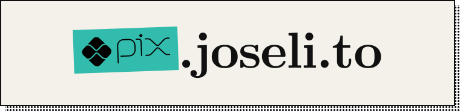
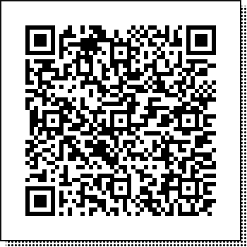
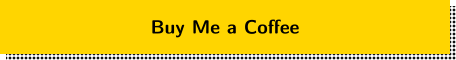
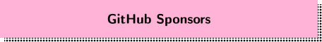

<a href="https://pix.joseli.to">
  <picture>
    <source media="(prefers-color-scheme: dark)" srcset=".github/readme/header-dark.svg">
    
  </picture>
</a>

&nbsp;

Se algo que eu fiz te ajudou, um Pix de qualquer valor ajuda a manter os projetos no ar.

*If something I made helped you, a Pix of any amount helps keep the projects running.*

## Pix

<picture>
  <source media="(prefers-color-scheme: dark)" srcset=".github/readme/qr-dark.svg">
  
</picture>

Aponte a câmera do app do banco. O valor fica a seu critério.<br>
*Point your bank app's camera at the code. The amount is up to you.*

**Chave Pix (e-mail)** · *Pix key (email)*

```
apoie@pix.joseli.to
```

**Pix copia e cola** · *Pix copy and paste*

```
00020126410014br.gov.bcb.pix0119apoie@pix.joseli.to5204000053039865802BR5908Joselito6006Recife62070503***6304CCF5
```

## Outras formas · Other ways

<a href="https://buymeacoffee.com/joselito">
  <picture>
    <source media="(prefers-color-scheme: dark)" srcset=".github/readme/coffee-dark.svg">
    
  </picture>
</a>
<br>
<a href="https://github.com/sponsors/breakzplatform">
  <picture>
    <source media="(prefers-color-scheme: dark)" srcset=".github/readme/sponsors-dark.svg">
    
  </picture>
</a>
